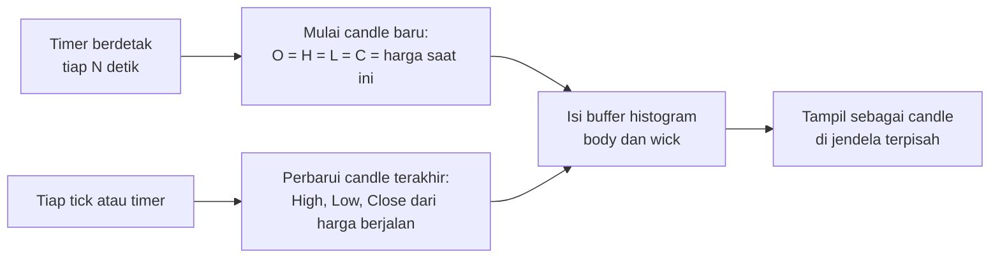
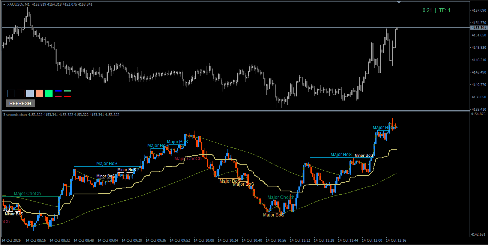

# Candles (Arbitrary Seconds) — Candle Berbasis Detik untuk MT4

> Indikator MetaTrader 4 yang membuat **candle baru setiap N detik** (berbasis timer) dan menggambarnya di jendela terpisah, sehingga pergerakan harga jangka sangat pendek bisa dilihat dengan interval yang lebih kecil dari M1.

---

## Ringkasan

**Candles (arbitrary seconds)** (`Candles_arbitrary_seconds_MT4_v1_3.mq4`, v1.30) adalah indikator *separate window* yang menggambar candle dengan **interval bebas dalam detik** (default 3 detik). MT4 hanya menyediakan timeframe tetap dengan interval terkecil M1; indikator ini menutup celah tersebut dengan sebuah timer yang memulai candle baru setiap N detik.

Cara kerjanya sederhana: setiap N detik, sebuah candle baru dimulai dengan `open = high = low = close =` harga saat itu. Selama candle itu berjalan, `high`, `low`, dan `close`-nya terus diperbarui dari harga berjalan. Candle terbaru selalu berada di tepi kanan jendela, dan candle yang lebih lama bergeser ke kiri.

Karena MT4 tidak memiliki gaya gambar candle untuk indikator, candle dibentuk dari histogram dan "penghapus" berwarna sama dengan background chart (teknik ini dijelaskan di bagian Cara Kerja).

---

## Fitur Utama

- **Interval bebas dalam detik** — mulai dari 1 detik, tanpa terikat timeframe MT4.
- **Tiga warna candle** — bullish, bearish, dan doji (`open = close`, ditampilkan sebagai garis tipis satu piksel).
- **Lebar body dan wick dapat diatur** (1 sampai 5) untuk menyesuaikan kerapatan candle.
- **Warna penghapus otomatis** — mengikuti warna background chart, atau bisa diatur manual.
- **Vertical zoom-out** — memberi ruang kosong di atas dan di bawah candle agar tidak selalu memenuhi tinggi jendela.
- **Batas memori** — jumlah candle yang disimpan diatur (default 5000); candle tertua dibuang bila penuh.
- **Ringan** — tanpa objek chart, tanpa file, tanpa DLL, dan tanpa fungsi trading.

---

## Cara Kerja (Konsep Umum)

### 1. Membuat candle baru

`EventSetTimer(N)` memicu `OnTimer` setiap N detik. Pada setiap pemicu, candle baru ditambahkan dengan seluruh nilai OHLC sama dengan harga saat ini. Harga diambil dari close bar 0 pada chart (`iClose(NULL, 0, 0)`), yaitu harga berjalan.

### 2. Memperbarui candle terakhir

Pada setiap tick dan setiap kali timer berdetak, candle terakhir diperbarui dari harga berjalan: `high` naik bila harga melampauinya, `low` turun bila harga menembusnya, dan `close` selalu sama dengan harga saat ini.

### 3. Menentukan warna

| Kondisi | Jenis | Warna default |
|---|---|---|
| `close > open` | Bullish | DodgerBlue |
| `close < open` | Bearish | OrangeRed |
| `close = open` | Doji | Gray (body setinggi satu piksel) |

### 4. Menggambar candle di MT4

Gaya `DRAW_HISTOGRAM` di MT4 selalu menggambar dari dasar jendela ke atas sampai nilai buffer, dan buffer yang indeksnya lebih tinggi menimpa yang lebih rendah. Maka sebuah candle yang "melayang" dibuat dengan dua langkah: sebuah kolom diwarnai dengan warna candle sampai ke nilai atasnya, lalu bagian bawahnya dihapus dengan kolom berwarna background. Indikator memakai **8 buffer**: body bearish, bullish, doji, dan penghapus body, serta wick bearish, bullish, doji, dan penghapus wick. Body digambar lebih dulu, wick di atasnya.

### 5. Posisi dan penyimpanan

- Candle terbaru digambar di bar 0 (tepi kanan), yang lebih lama ke kiri.
- Candle disimpan di memori sebanyak `InpMaxCandles`; saat penuh, candle tertua dibuang.
- Jumlah candle yang tergambar juga dibatasi oleh jumlah bar yang ada pada chart.

### 6. Vertical zoom-out

MT4 menskalakan jendela indikator mengikuti nilai bar yang terlihat, sehingga bila candle masih sedikit, candle memenuhi seluruh tinggi jendela. Untuk memberi ruang, indikator menyembunyikan dua nilai ekstrem (di atas `high` tertinggi dan di bawah `low` terendah) pada bar kosong pertama, memakai buffer penghapus berwarna background. Jarak tambahan sebesar `InpScalePadding`% dari rentang candle yang terlihat, minimal 10 Point. Efek ini hanya berlaku selama masih ada bar kosong yang terlihat di layar.

### Catatan dan batasan

- **Tidak ada histori.** Candle dibangun mulai saat indikator dipasang dan hanya disimpan di memori. Candle hilang saat timeframe chart diganti, parameter diubah, indikator dipasang ulang, atau MT4 di-restart.
- **Candle pertama muncul setelah N detik** karena candle baru dibuat oleh timer.
- **Harga hanya berubah saat ada tick.** Bila pasar sepi atau tutup, candle baru tetap terbentuk setiap N detik sebagai doji datar (`O = H = L = C`).
- **Ketepatan interval** bergantung pada timer terminal MT4 dan beban komputer, terutama untuk interval 1–2 detik.
- **Warna penghapus dibaca saat indikator diinisialisasi.** Bila warna background chart diganti sesudahnya, atur `InpBackColor` atau pasang ulang indikator.
- Karena candle dibentuk dari histogram, nilai di **Data Window** adalah nilai buffer (`Body bear`, `Body bull`, `Body doji`, `Body eraser`, `Wick bear`, `Wick bull`, `Wick doji`, `Wick eraser`), bukan nilai OHLC.
- Indikator tidak menampilkan volume dan tidak membuat alert.

---

## Kebutuhan Sistem

- **MetaTrader 4**, build 600 atau lebih baru (memakai `EventSetTimer` dan `OnTimer`).
- Terminal harus tetap terbuka dan terhubung ke feed harga agar candle terus terbentuk.
- Chart dengan jumlah bar yang cukup (jumlah candle yang tergambar dibatasi jumlah bar chart).
- Tidak memerlukan DLL, WebRequest, ataupun izin trading.

---

## Instalasi

1. Unduh file `Candles_arbitrary_seconds_MT4_v1_3.mq4` dari repositori ini.
2. Di MT4, buka **File → Open Data Folder**, lalu masuk ke `MQL4\Indicators`.
3. Salin file `.mq4` ke folder tersebut.
4. Buka **MetaEditor** (tekan `F4` di MT4), buka file tadi, lalu tekan **Compile** (`F7`). Pastikan tidak ada error.
5. Kembali ke MT4, klik kanan panel **Navigator → Refresh** (atau restart MT4). Indikator muncul di bagian *Indicators* dengan nama **Candles_arbitrary_seconds_MT4_v1_3**.

---

## Cara Pakai

1. Buka chart simbol yang ingin dipantau (timeframe bebas).
2. Seret **Candles_arbitrary_seconds_MT4_v1_3** dari Navigator ke chart. Sebuah jendela baru bernama `N seconds chart` (misalnya `3 seconds chart`) muncul di bawah chart utama.
3. Tunggu sebentar. Candle pertama muncul setelah N detik, lalu candle baru ditambahkan tiap N detik.
4. Ubah `InpSeconds` di properti indikator (`Ctrl+I`) untuk mengganti interval. Seluruh candle akan dimulai dari awal.
5. Seret batas atas jendela indikator untuk memperbesar tinggi jendela, dan gunakan zoom chart (tombol `+` / `-`) untuk mengatur jarak antar-candle.

**Perilaku saat ganti kondisi:**

- Ganti timeframe atau ubah parameter → candle dimulai dari awal (histori tidak tersimpan).
- Indikator dilepas → timer dihentikan.

**Jika tampilan tidak sesuai:**

- *Candle belum muncul* — tunggu minimal N detik dan pastikan ada tick masuk.
- *Garis atau blok aneh di bawah candle* — warna penghapus tidak sama dengan background chart; atur `InpBackColor` ke warna background atau pasang ulang indikator.
- *Hampir semua candle berupa garis abu-abu datar* — pasar sepi atau tutup, sehingga harga tidak berubah dalam interval tersebut.
- *Candle terlalu rapat memenuhi tinggi jendela* — naikkan `InpScalePadding`.

---

## Konfigurasi

| Tujuan | Setelan |
|---|---|
| Pantau pergerakan sangat cepat | Turunkan `InpSeconds` (minimum 1) |
| Candle lebih ringkas dan tahan lebih lama | Naikkan `InpSeconds` |
| Menyimpan lebih banyak candle di memori | Naikkan `InpMaxCandles` |
| Candle lebih tebal atau tipis | Atur `InpBodyWidth` dan `InpWickWidth` (1–5; body 3 = candle normal) |
| Mengganti warna | Atur `InpBullColor`, `InpBearColor`, `InpDojiColor` |
| Chart memakai warna background khusus | Atur `InpBackColor`, atau biarkan `clrNONE` agar otomatis mengikuti background chart |
| Lebih banyak ruang di atas dan bawah candle | Naikkan `InpScalePadding` |
| Skala rapat mengikuti candle (tanpa ruang tambahan) | Set `InpScalePadding = 0` |

---

## Parameter Input

| Parameter | Default | Keterangan |
|---|---|---|
| `InpSeconds` | `3` | Interval candle dalam detik (minimum 1) |
| `InpMaxCandles` | `5000` | Jumlah candle yang disimpan di memori (minimum 10) |
| `InpBodyWidth` | `3` | Lebar body candle, 1–5 (3 = candle normal) |
| `InpWickWidth` | `1` | Lebar wick candle, 1–5 |
| `InpBullColor` | `clrDodgerBlue` | Warna candle bullish |
| `InpBearColor` | `clrOrangeRed` | Warna candle bearish |
| `InpDojiColor` | `clrGray` | Warna candle doji (`open = close`) |
| `InpBackColor` | `clrNONE` | Warna penghapus; `clrNONE` = otomatis mengikuti background chart |
| `InpScalePadding` | `50` | Ruang tambahan di atas dan bawah dalam % dari rentang candle yang terlihat (0 = auto-scale biasa) |

---

## Tampilan

| Elemen | Bentuk | Warna default | Arti |
|---|---|---|---|
| Candle bullish | Body + wick | DodgerBlue | `close > open` pada interval tersebut |
| Candle bearish | Body + wick | OrangeRed | `close < open` pada interval tersebut |
| Candle doji | Garis datar dengan body satu piksel | Gray | `open = close` |
| Candle terbaru | Di tepi kanan jendela | — | Candle yang sedang berjalan; terus berubah mengikuti harga |
| Penghapus | Tak terlihat | Sama dengan background | Menutupi bagian bawah kolom histogram agar candle tampak melayang |

Judul jendela indikator berbentuk `N seconds chart` sesuai nilai `InpSeconds`.

---

## Disclaimer

Indikator ini adalah alat bantu visual dan **bukan** saran investasi, rekomendasi beli/jual, ataupun jaminan hasil. Trading forex, emas, dan instrumen margin lainnya berisiko tinggi dan dapat menyebabkan kerugian melebihi modal. Candle detik yang ditampilkan dibangun dari harga berjalan yang diterima terminal, sehingga dapat berbeda antar broker dan koneksi, dan tidak sama dengan data tick historis.

Software disediakan **"apa adanya" (as is)** tanpa garansi apa pun. Pengguna bertanggung jawab penuh atas keputusan trading masing-masing. Uji terlebih dahulu di akun demo sebelum dipakai di akun riil.

---

## Lisensi

MIT Licence
